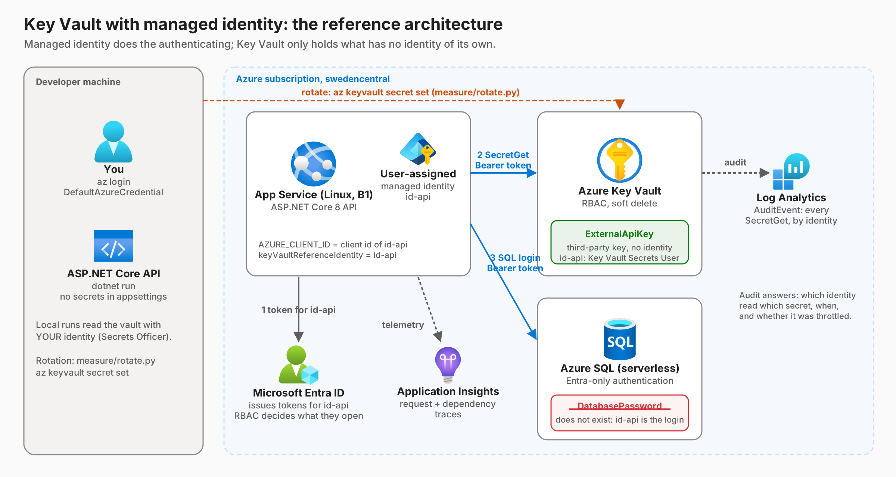
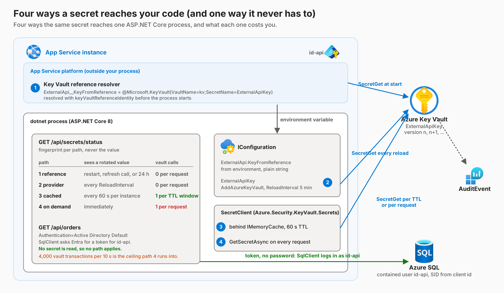

# key-vault-secrets-azure

Companion sample for the Cloud Perspectives post **"Azure Key Vault and Managed Identity: The Secret You Should Not Store"** (sjwiggers.com).

An ASP.NET Core 8 API on App Service reads one secret from Azure Key Vault with a user-assigned managed identity, four different ways, and logs in to Azure SQL with the same identity and no password at all. Two scripts measure what the four-step "store, enable identity, grant, read" summary leaves out: how fast a rotated secret reaches a running app per path, and how many vault calls each path really makes.



## What gets deployed

| Resource | Purpose |
|---|---|
| App Service (Linux, B1) + user-assigned identity `id-api` | The API. `AZURE_CLIENT_ID` and `keyVaultReferenceIdentity` both point at `id-api`. |
| Key Vault (RBAC, soft delete) with secret `ExternalApiKey` | The one secret that has no identity of its own. `id-api` is **Key Vault Secrets User**, you are **Key Vault Secrets Officer**. |
| Azure SQL serverless, Entra-only authentication | No SQL password exists. A contained user for `id-api` is created by SID in a post-provision step. |
| Log Analytics + Application Insights | Key Vault `AuditEvent` diagnostics and app telemetry. |

## The four paths



| # | Path | Sees a rotated value | Vault calls |
|---|---|---|---|
| 1 | App Service Key Vault reference in app settings | restart, refresh call, or the platform's 24 h refetch | 0 per request |
| 2 | `AddAzureKeyVault` configuration provider | every `ReloadInterval` (5 min) | 0 per request |
| 3 | `SecretClient` behind `IMemoryCache` (60 s TTL) | within the TTL | 1 per TTL window per instance |
| 4 | `SecretClient.GetSecretAsync` per request | immediately | 1 per request |

`GET /api/secrets/status` returns a fingerprint (truncated SHA-256) of the value each path holds. The secret is never returned.
`GET /api/secrets/{reference|provider|cached|ondemand}` returns one path.
`GET /api/orders` opens SQL as `id-api` and returns `SUSER_SNAME()` plus a row count.

## Deploy

Prerequisites: `az`, `azd`, .NET 8 SDK, Python 3.10+ (standard library only), Windows PowerShell 5.1 or pwsh for the hooks.

```powershell
az login --tenant <tenant>
azd auth login
Get-ChildItem .\scripts\*.ps1 | Unblock-File   # if Windows marks the scripts as downloaded
azd env new key-vault-secrets                   # or any name; pick swedencentral when asked
.\scripts\preprovision.ps1                     # once, by hand: azd resolves Bicep parameters BEFORE hooks run
azd up
```

If you skip the manual `preprovision.ps1` on the first run, azd prompts for `deployerLogin` and `deployerObjectId` before the hook can fill them. Press Enter on neither: give your sign-in name and object id, or cancel, run the script, and `azd config unset infra.parameters.deployerLogin` / `...deployerObjectId` to drop the prompted values. Later runs read them from the environment.

`azd up` runs:

1. `scripts/preprovision.ps1`: reads your object id and login from the claims of your `az` access token (no Microsoft Graph call) plus your public IP, and stores them in the azd environment. Bicep makes you the SQL Entra admin and a Key Vault Secrets Officer, and opens the SQL firewall for your IP.
2. Bicep (`infra/`).
3. `scripts/create-sql-user.ps1`: connects to SQL with an `az` access token (no password) and creates the contained user for `id-api` from its client id.
4. Deploys the API.

Then open `$(azd env get-value API_URL)/api/secrets/status` and `/api/orders`.

On macOS or Linux the post-provision step prints a reminder; run the T-SQL in `scripts/create-sql-user.ps1` with your tool of choice as the SQL admin.

## Measure

```powershell
python measure/rotate.py --refresh      # rotate, poll 15 min, then force a reference refresh
python measure/rotate.py --restart      # same, but restart the web app instead
python measure/burst.py --path ondemand --count 200 --query
python measure/burst.py --path cached   --count 200 --query
python measure/burst.py --path provider --count 200 --query
python images/make_diagrams.py          # redraws the diagrams and, with rotate-result.json present, the rotation timeline
```

`measure/audit.kql` holds the Log Analytics queries: SecretGet per identity, throttling, who rotated, and forbidden reads.

`scripts/refresh-references.ps1` is the documented escape hatch for path 1: it forces App Service to re-resolve all Key Vault references without a restart.

## Local run

```powershell
$env:KeyVault__Uri = (azd env get-value KEY_VAULT_URI)
$env:Sql__ConnectionString = "Server=tcp:$(azd env get-value SQL_SERVER_FQDN),1433;Database=orders;Authentication=Active Directory Default;Encrypt=True;"
dotnet run --project src/api
```

`DefaultAzureCredential` uses your `az login`. Path 1 has no local equivalent and shows no fingerprint. Your reads show up in the audit log under your UPN, which is exactly the argument for a separate vault per environment.

## Clean up

```powershell
azd down --purge
```

## Layout

```
infra/            Bicep: identity, Key Vault + secret + diagnostics, SQL (Entra-only), App Service, role module
src/api/          ASP.NET Core 8 minimal API: SecretPaths.cs (four paths), SqlProbe.cs, SchemaBootstrapper.cs
scripts/          preprovision, create-sql-user (token auth, SID-based user), refresh-references
measure/          rotate.py, burst.py, audit.kql
images/           make_diagrams.py + the Azure Public Service Icons it uses
docs/             the blog post draft and the deployment walkthrough
```

Icons: Microsoft Azure Public Service Icons (V24), used unmodified.
